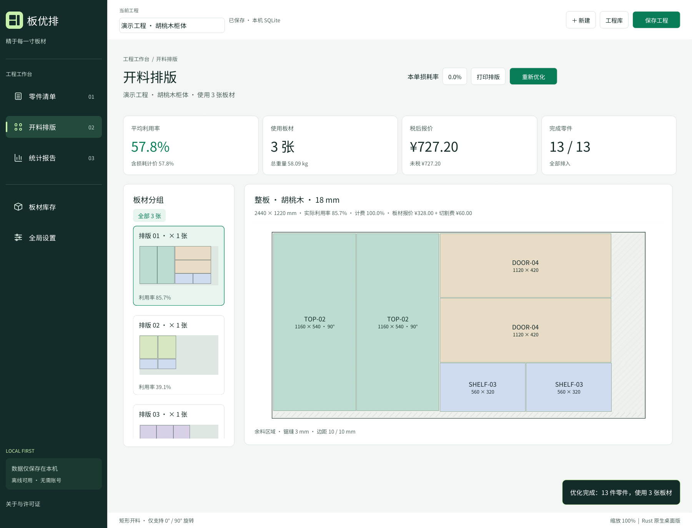
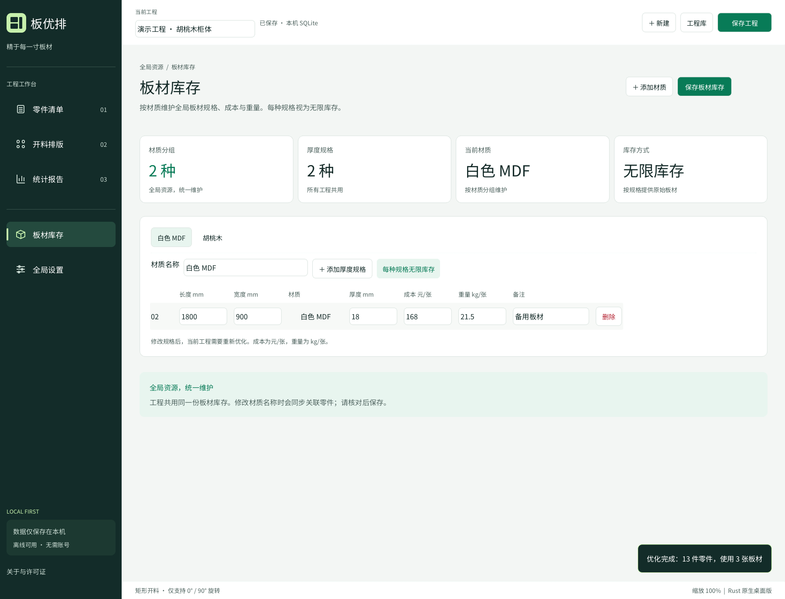
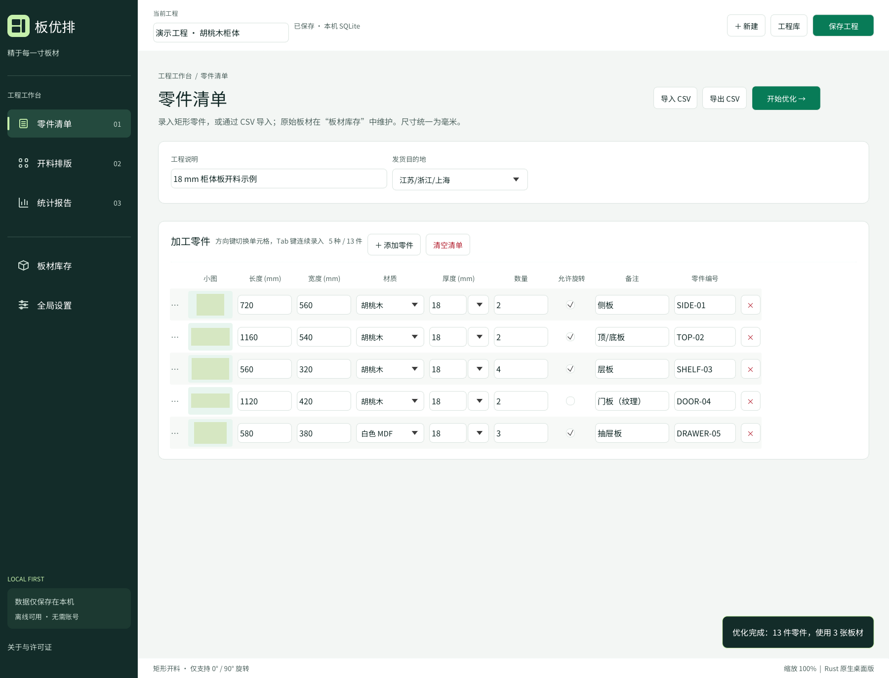
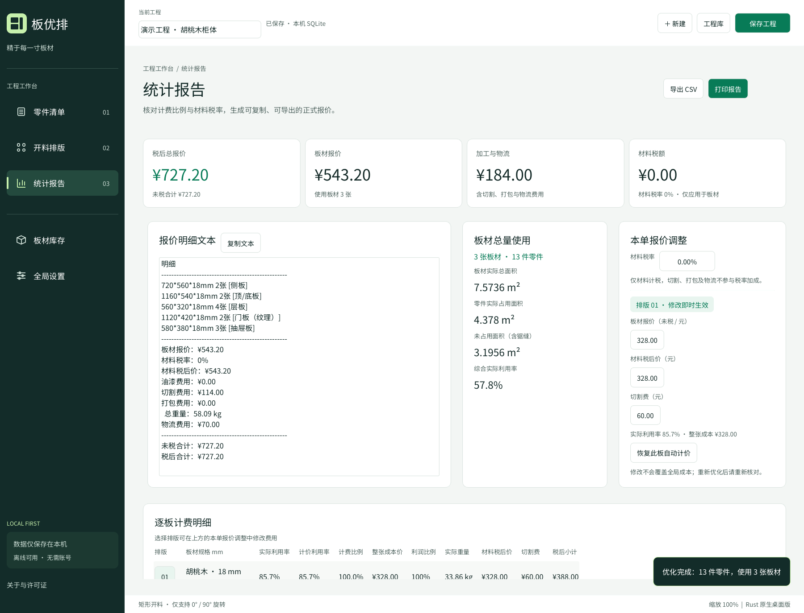

# 板优排 · Rust 原生桌面版

**从零件清单到开料图，再到一份可核对的报价。**

板优排是面向矩形板材加工的 Windows x64 工具。录入零件尺寸，生成开料方案，再按实际用料核对费用。工程保存在本机，无需账号或联网。

[看操作流程](#从库存到报价) · [运行与构建](#运行与构建) · [数据与升级](#数据与升级)



*胡桃木柜体演示工程：13 件零件排入 3 张板材。截图使用内置演示数据。*

## 从库存到报价

### 01 · 建立板材库存

按材质建立常用规格，填写板材长宽、厚度、成本和重量。库存由各工程共用，录入零件时可直接选用对应材质的厚度。



### 02 · 录入零件，生成开料图

逐行填写尺寸和数量，或导入 CSV。有纹理方向的门板可单独取消旋转。点击「开始优化」，即可按板查看零件位置、利用率和余料区域。



### 03 · 核对费用，输出报价

在「统计报告」核对板材用量、加工和物流费用。可修改本单材料税率，或逐板调整价格并恢复自动计价。全部零件排入后，即可复制报价、导出 CSV 或打印报告。



## 运行与构建

目标系统为 Windows 10/11 x64，需要正常的 OpenGL 显卡驱动。应用使用 Rust + egui + SQLite，无需 Node.js、Electron、WebView2 或本地 HTTP 服务。

构建需要 Rust stable MSVC x64、Visual Studio C++ Build Tools 和 Windows SDK。在仓库根目录执行：

```powershell
powershell -NoProfile -ExecutionPolicy Bypass -File tools/build-rust-win.ps1
```

脚本执行格式检查、严格 Clippy、Rust 测试、锁定依赖的 release 构建、PE 依赖检查和原生窗口烟雾测试，输出到 `dist/rust-native/`，不会覆盖用户数据库。

开发运行及测试（在 `rust-app/` 中执行，以加载 `.cargo/config.toml`）：

```powershell
cd rust-app
cargo fmt --check
cargo clippy --locked --all-targets --target x86_64-pc-windows-msvc -- -D warnings
cargo test --locked --target x86_64-pc-windows-msvc
cargo run --target x86_64-pc-windows-msvc -- --demo
```

`--demo` 使用内存数据库，不读取或修改用户数据库；退出后丢弃演示数据。

## 主要功能

- 板材库存、材质/厚度联动、零件表格录入、CSV 导入导出。
- MaxRects 多策略贴合及矩形束搜索，快速/深度优化、锯缝、裁边、余料展示和重复排版合并。
- 旋转仅支持 0° / 90°；“批量允许旋转”切换时统一设置全部零件，之后可单独调整，排版以单件设置为准。
- 后台优化、实时试排、停止和 60 秒超时；试排不作为最终方案或正式报价。
- 利用率阶梯计费、损耗率、利润、切割费、打包费、物流、材料税率及逐板手动报价调整。
- 报价模板、剪贴板、CSV 报告、打印预览和 Windows 原生打印；有零件未排入时禁止正式报价及报告导出。
- SQLite 工程库、自动保存、独立全局配置、历史数据库兼容和事务迁移备份。
- Tab/回车连续录入、Shift 反向移动、方向键导航、末格新增，以及 50%–200% 界面缩放。

不支持 CAD、异形轮廓、内孔套排或指定角度。历史工程中的相关数据会保留并提示，需要删除相关行后重新录入矩形零件。

## 数据与升级

数据库位于 EXE 同级 `data/board_cut_optimizer.sqlite`，已有 `data/smartcut.sqlite` 时兼容使用旧名称。可通过 `BOARD_CUT_OPTIMIZER_DB_PATH` 指定路径，兼容旧变量 `SMARTCUT_DB_PATH`。

移动便携版时须同时复制整个 `data/` 文件夹。升级前关闭程序并备份数据，不要让多个版本同时编辑同一个数据库。历史 SQLite 数据读取不依赖旧版程序；仅存在旧浏览器 localStorage 中的数据不在本版迁移范围内。

此次清理保留根目录及 Rust 发布目录的全部数据，原 `dist/win-unpacked/data/` 已备份到 `data/legacy-electron-backup/`，没有覆盖当前数据库。

## CSV 与计价

零件 CSV 固定四列：`数量,长度,宽度,厚度`。数量须为非负整数，0 表示不参与排版。长度和宽度须为有限正数；参与排版的零件厚度须匹配库存首个材质的可用厚度。导入默认允许旋转；所有行通过校验后才可导入，替换现有清单需确认。

板材成本单位为元/张，重量为 kg/张。计价利用率为实际利用率加本单损耗率（最高 100%）；80% 及以上按整张，低于 80% 向上取整至 10% 阶梯。板材报价乘以全局利润比例；切割费采用相同计费比例，整板件不收切割费。打包费按单计费，材料税率仅应用于板材报价。上海库沓物流按实际用量重量计算，乘以 120% 后向上取整到整十元。

## 目录与验证

- `rust-app/src/`：业务逻辑、原生界面与系统集成。
- `rust-app/resources/`：嵌入字体、图标及许可证。
- `rust-app/tests/`：Rust 回归测试；`fixtures/` 中的历史 JSON/SQLite 样例是静态兼容数据，不包含旧版运行代码，测试无需 Node.js。
- `tools/build-rust-win.ps1`：Windows 原生构建与发布检查。

详细运行说明见 [`rust-app/RELEASE_NOTES.md`](rust-app/RELEASE_NOTES.md)，功能验证与人工待验事项见 [`rust-app/FEATURE_PARITY.md`](rust-app/FEATURE_PARITY.md)。
