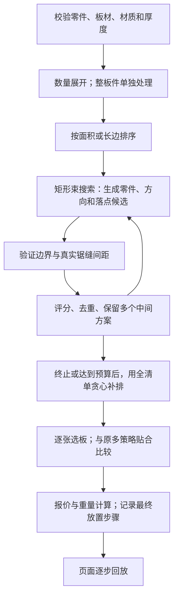

# Solid Edge 2D Nesting 2024：静态逆向与板优排矩形适配

> 本文记录第一阶段矩形实现。后续异形、内孔、任意角和原长宽计量口径见 [异形与任意角实现](异形与任意角实现.md)，后者优先。

分析日期：2026-10-26。

## 结论与范围

已经使用 REA 完成主程序身份、托管/本地边界、解压后本地库及关键函数的静态分析，并在板优排加入**独立编写的矩形束搜索实现**和逐件放置演示。

**没有完整还原 Solid Edge 的商业排板内核，也没有验证两者对同一工程输出一致。** 不能把本文的独立实现称为原厂算法的逐行移植。原程序的异形件、任意角旋转、孔洞套排、共边切割、完整分桶评分及持续迭代控制尚未移植。原软件没有被启动或修改。

原库是多策略系统，已确认存在束搜索、矩形排版、无碰撞位置图和其他处理模块。模块存在以及静态调用不等于所有工程都会走这些路径。当前接入的是适合板优排矩形数据的部分，原有报价、材质厚度隔离及整板件规则继续生效。

## 1. 目标身份与证据

| 文件 | 识别结果 | SHA-256 |
| --- | --- | --- |
| `D:\SoftWare\Solid Edge 2D Nesting 2024\se2dnest.exe` | x64，CIL，.NET Framework 4.8，程序集 224.0.0.6，MVID `34db1f37-e00f-404a-8b4d-5ac3e3200a93` | `09c5f718a017323ef5f085a3708229c1dea7c0efbd2f55896622ae6fc7667b53` |
| 原始 `libcns.dll` | x64 PE，本地压缩库 | `592babb4e3717b0030c118043d1acf55f53675fe34228880e2dc6ce138160c5d` |
| 工作区 `libcns-unpacked.dll` | 单独派生的静态分析副本 | `c5200a98ced3e8a9c0591574074eaa9a944aa7c51ea040f847ef11f30e29c7b5` |

身份依据：REA `ev_172ef85fd262bafba4056ef6b94c68c7d053e27b01811c8afed8336d3965d71c`。托管成员依据：`ev_99b2305bc3386c53f1e6648c8628710d030bec6d73d645dcd8937f1af7a09d43`。

完整 REA 记录保存在同目录 `rea-evidence.json`；关键函数的完整反编译伪代码在 `pseudocode/`。这些是反编译器输出，不是原始 C++ 源码，类型、签名和部分控制流仍存在恢复误差。

## 2. 如何找到真正的计算库

1. 用 REA `open_binary` 识别主程序。原生分析器拒绝托管 PE 后，改用 `inspect_managed_artifact` 与 `inspect_managed_members`。
2. 从元数据找到 `AtlasManaged.Nesting`、`AtlasManaged.NestProblem` 和本地接口声明。
3. `inspect_managed_native_boundaries` 找到 172 项 P/Invoke 声明，其中大量通过序号引用 `libcns.dll`。这证明接口声明存在；没有把托管 token 当成本地地址，也没有宣称已逐一验证所有序号映射。
4. 打开原始 DLL，只发现 212 个已识别过程和 36 个字符串；段名含 `BAB0`、`UPX1`，说明应先处理压缩副本，而不能把解压入口当成排板器。
5. 仅在工作区副本将第一段的八字节名称由 `BAB0\0\0\0\0` 恢复为 `UPX0\0\0\0\0`。使用官方 UPX 5.0.2 解压得到 14,366,222 字节分析副本。未改动原安装目录。
6. 用 REA/Ghidra 12.1.2 分析解压副本，通过字符串交叉引用定位函数，再读反编译结果。

P/Invoke 依据：`ev_46acf76e060253e894ff862db0108b3b3ecee5115524cdee2bc9c26cd22225ae`。压缩原库概览：`ev_03452330b57051d2687b4a25b8981014af517087ea21262117f3123d1b4fa385`。副本变换详情及来源在 `derivation.json`；工具来源为 [UPX 官方发布](https://github.com/upx/upx/releases/tag/v5.0.2)。

## 3. 原软件已确认的结构

下表地址均属于**解压副本**，不能直接当作原压缩文件偏移。

| 观察 | 函数/位置 | 证据及边界 |
| --- | --- | --- |
| 注册多种模块名称：`Multi::Compact`、`Multi::Nesting`、`Multi::BeamNesting`、`Multi::Rectangle`、`Multi::Filling`、`Multi::HoleRenester` 等 | `0x26b7509a0` | `ev_36c1b5388e13de1105735b60dc170e192b7445fe5b920c9b25243b26e3ff790a`；这是注册/初始化，不是已执行的排板顺序 |
| 束搜索配置含 width、buckets、comparisons mode、degree | `0x26b3b69f0` | `ev_372f9f8878e63862d529dd61038339d6e6af25bad421f7394ac7ea11fbfe34b1`；构造/日志逻辑确认参数存在，默认值未完整确认 |
| 搜索树准备依次出现 `Length reduced`、`Simplified`、`Offsets computed` | `0x26aef3b60` | `ev_731d89b1449c10080d30a0543e47d586b9b34761772410d12355ad22e266e958`；取消条件会跳过阶段，偏移的完整几何语义未恢复 |
| 主搜索调用上述配置与树准备，反复提取候选、构造后继、更新桶 | `0x26aed5430` | `ev_2a198ed516c389fcb0b3f9c29f63b03bb634742f8d46363fc4e0fc5b3d4fcdf5`；反编译器报告类型传播不收敛，不能逐行直接翻译 |
| 候选从首个非空桶取出，排序，并比较成对标识去重 | `0x26aed4e80` | `ev_a38bfe0b207c207d0154982b0e3ff18eabb1e3434b6dc4399ad110e69c4fb228`；成对标识的准确业务含义未知 |
| 汇总多个子项评价：计数累加、按权重组合浮点评价 | `0x26aef5870` | `ev_46f7d014bad8a18c44b92cef65c81cbd19c2b717d7e7a3b6904da9552699e32e`；评价字段的完整含义和权重尚未恢复 |
| 矩形路径会生成工具包围框；放置循环有候选评价及可选随机扰动，再写入选中位置 | `0x26acd1d60`、`0x26accfb50` | `ev_09243aa5c5501a5cb9aee687fd0ed97c5959fa34e90dd38be0f35503d4556657`、`ev_81087b05ac12e837008e1417edb394c84d8a8135c1ec3ca7edb43c6c484bfafc`；不是简单固定排序后一次放置 |
| `GetNoFitPlacementMap` 接口把角度归一化到一周，并调用几何构造函数 | `0x26ac566e0` | `ev_831e00a1763a22283d4b7074c6555f00349f845dad3bd14aa064d12f0747a8ac`；不能据此宣称已恢复其完整 NFP/Minkowski 构造 |

字符串线索依据：`ev_0ca05a328d1cbf94bbd6822cfa59ede4936beb8982a2fc879b8a199ff352138a`。`string-candidates.json` 是额外的普通文件字节扫描结果，不冒充 REA 证据。

上述观察支持“多策略 + 有界束搜索 + 几何候选与评价”的结构性理解。**没有证据证明整个系统以遗传算法为主，也未声称已经找到全局最优保证。**

## 4. 板优排实际实现：每一步

以下是本项目的设计选择。凡涉及排序、分值或预算，均不是已经恢复的原厂参数。

### 第一步：数据校验及实例展开

`engine.mjs` 的 `validateProject`、`expandParts`、`expandPanels` 校验尺寸和数量，将每件零件赋予稳定 `instanceId`。仍以材质和厚度同时匹配来分配板材。`1220×2440` 整板件沿用原有单张免切割规则。

### 第二步：保留原算法作为候选

`optimizeCuttingPlan` 保留原 MaxRects 贴合：快速模式 1 种排序×3 种方向偏好；深度模式 4 种排序×3 种方向偏好。全局禁转时方向策略缩减为一种。

新增束搜索：快速模式再比较面积排序的一次搜索；深度模式再比较面积与长边排序的两次搜索。全局允许旋转时，通常分别是 4 个和 14 个完整方案。最终优胜方案可能来自原贴合，也可能来自束搜索。

### 第三步：构建可用板面

`beam-nesting.mjs` 的 `fillRectangleSheet` 从四周对称边距得到 `[left,right]×[top,bottom]`，创建空状态：`placements=[]`、`usedArea=0`。

### 第四步：生成候选

`orientations` 根据全局和单件许可生成 0°/90° 两种方向。`anchors` 从板面左上角，以及已放件右边/下边加锯缝的位置生成 X、Y 坐标，再枚举交叉落点。

这是矩形专用的接触边锚点采样，**没有移植原库的通用多边形无碰撞图**，不保证枚举所有可能的连续几何摆法。

`children` 每层选择前若干个不同可放规格。某些大件放不下时会继续检查后面的小件，不会只检查列表开头便放弃。

### 第五步：真实几何约束

`fits` 检查候选在可用板面内；对每个已放件，至少满足左、右、上、下四向之一的分离条件。例如：

`candidate.x + candidate.width + sawWidth <= placed.x`

或其余三个方向的等价条件。该规则防止重叠，也防止内部自由区边界截掉锯缝。板外不额外预留锯缝，所以 `100+8+100` 可以恰好放入 208 mm 板。

### 第六步：评分、去重与保留搜索宽度

`stateScore` 使用本项目自定的字典序：

1. 已放净面积越大越好；
2. 包络面积越小越好；
3. 已放件数越多越好；
4. 再比较下边界和右边界，稳定打破并列。

`stateKey` 按实例编号、位置及旋转状态生成稳定键，避免重复保留同一布局。每层排序后保留 `beamWidth` 个不同状态。束宽大于 1 时会真正保留多条搜索路径。

### 第七步：限定工作量并补排

| 参数 | 快速 | 深度 |
| --- | --- | --- |
| 束宽 | 2 | 4 |
| 候选规格上限 | 4 | 6 |
| 启用分层搜索的件数上限（当前板候选组） | 24 | 40 |
| 候选落点检查预算（每次单板搜索） | 1200 | 5000 |

数量超限时直接用接触边贪心填充；搜索预算耗尽时从当前最好状态补排。补排读取完整候选清单，不会丢弃尾部零件。预算限制的是分层搜索，**不包括后续贪心扫描，不是整个工程的耗时上限**。

### 第八步：板材选择和完整方案比较

`runAttempt` 试排可匹配板材，根据单板利用率和板面面积选板，移除已放实例，继续处理剩余零件。

完整方案沿用原项目的比较序：`[未排件数, 使用板材面积−零件面积, 张数]`。它不是原软件已经恢复的评分公式，也不是保证最少张数的精确求解器。

`optimizeCuttingPlan(project, { includeBeam:false })` 可仅运行原策略，供开发回归比较使用；页面默认使用组合优化。

### 第九步：计价及结果兼容

继续复用单张利用率、损耗率、阶梯计费、利润、切割费、重量、打包和物流计算。没有调用或分发商业 DLL，不引入原软件的许可或运行时依赖。

结果新增 `algorithm`、`attemptsSummary`、`trace`。原来的 `layouts`、`unplaced`、`stats` 保持兼容。`trace` 只收录最终方案每件的实际坐标与方向，不混入被淘汰的试排。

### 第十步：逐步展示

在“开料排版”展开“逐步查看排版过程”，选择实际板材，使用上/下一步或滑块，从空板回放到该板最后一件。当前件高亮，文字列出坐标、尺寸和方向。

这是**最终方案的放置回放，不是搜索树全部分支，也不是机床切割顺序**。最终余料仅在最后一步展示；库存、零件或设置变更使旧结果失效时，演示同步清除。

## 5. 验证

`npm test` 覆盖原有业务回归及新增束搜索测试。新增检查包括：

- 已知锯缝不足复现、精确贴板边、禁转、材质和厚度隔离；
- 60 组完整优化器及 24 组束搜索的确定性随机几何检查；
- 数量超限、预算耗尽、大件后面仍有可放小件、输入不变；
- `trace` 与最终坐标逐项一致，实例无重复、数量守恒；
- 原报价、税率、重量、物流和 SQLite 测试。

固定对照工程：300×300 mm 板、锯缝 3 mm、边距 0、允许旋转，各 1 件：

`80×85,160×116,74×31,168×113,144×37,77×117,51×157,121×93,60×102,136×134,162×106,63×173,73×151,79×151`

原多策略贴合需要 **3 张**，组合优化选择束搜索后使用 **2 张**，14 件全部排入且几何有效。这是本项目内部前后对比，**不是与 Solid Edge 结果的一致性或优劣比较**。

独立束宽测试：100×100 板的固定 8 件样例，束宽 1 可排面积 7100，束宽 4 可排面积 7700。该样例证明多分支探索确实生效，不代表所有工程均有改善。

## 6. 原请求核对与未解决部分

| 问题 | 状态 |
| --- | --- |
| 找到主程序与计算库边界 | 已回答；接口声明不等于全部导出逐项映射已验证 |
| 静态确认束搜索、矩形和几何图结构 | 已回答到关键模块及控制流程层面 |
| 恢复原厂全部评分、分桶和调度规则 | 部分回答；字段和间接调用仍未完全恢复 |
| 展示板优排实际实现的每一步 | 已完成：本文与页面逐件回放 |
| 在板优排实现矩形适配算法 | 已完成独立实现；不是原厂内核等价复刻 |
| 与原软件受控输入/输出对照 | 未完成；未运行原软件 |
| 原厂异形、孔洞、任意角和共边能力 | 未实现，仍超出当前板优排矩形模型 |

下一阶段要验证等价性，应建立原软件可运行的固定工程，记录相同边距、间距、旋转、时间预算下的输出，再围绕差异继续恢复原生调用和评价字段。现有证据与派生副本可复用，无需重新改动原文件。
